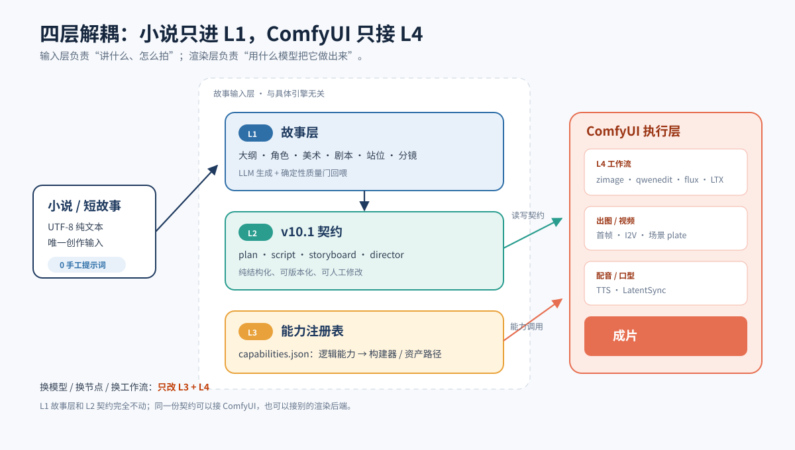
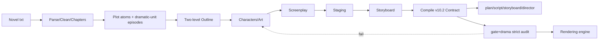
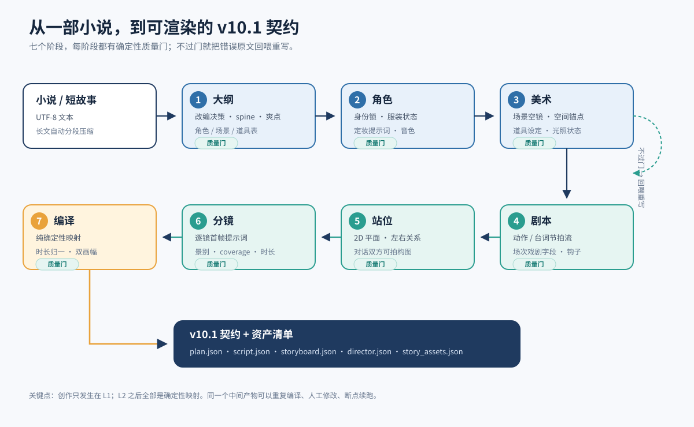
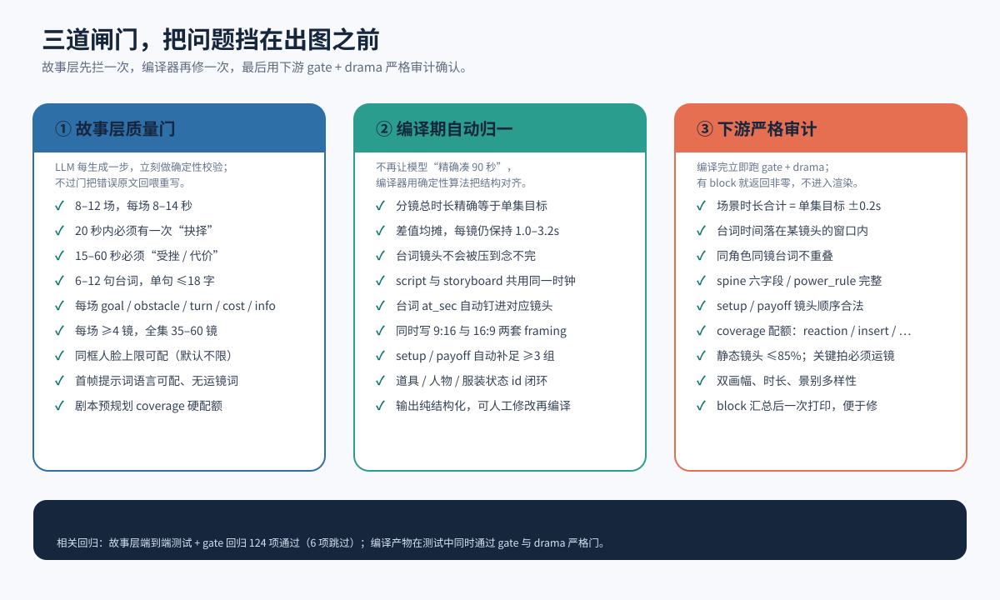

# Manju Story Input Layer

> **A novel in, a renderable anime-drama contract out.**

> **Copyright**
>
> **All Rights Reserved.** You may view this repository for reference only. No copying, modification or redistribution is permitted without my written permission.
>
> Some code is AI-assisted and has been human-reviewed and revised.


[中文](./README.md) · [Quick Start](#quick-start) · [Two Ways to Use](#two-ways-to-use) · [Docs](#docs) · Version v2.0 / Contract v10.2

Manju is an automated **novel → screenplay → storyboard → render contract** pipeline. It fully separates "writing a story" from "operating AI models": drop in a novel, and it handles parsing, compression, episode splitting, screenplay writing and storyboarding — finally producing a **purely structured, engine-agnostic render contract**. Whether the downstream uses ComfyUI, Seedance or any other engine, it only consumes this contract.

The project ships **two frontends** — a command-line tool and a local web UI (Manju Studio). Both share the same pipeline and produce identical artifacts; switch between them at any time.

---

## Two Ways to Use

| | CLI `story_cli` | Manju Studio |
|---|---|---|
| **Best for** | batch runs, servers/CI, scripting, full parameter access | solo creation, per-shot editing, visual review, iterate while watching |
| **Start** | `python -m manju.story_cli input\my_story.txt --yes` | `.\scripts\studio.ps1` → `http://127.0.0.1:8092` |
| **Generate** | full options, ranged runs, strict gates, `--resume` | "Generate" page picks novel/split mode/range; calls the same `story_cli` in the background |
| **Edit** | edit `state/story/<novel>/*.json` directly | per-shot editor; visual editors for assets/style/world |
| **Publish** | compiled automatically on success; rerun `--resume` after edits | "Publish Contract" button, same compile + gate/drama audit |
| **Tutorial** | [`docs/小说输入层使用教程.en.md`](docs/小说输入层使用教程.en.md) | [`docs/Studio使用教程.md`](docs/Studio使用教程.md) |

> Both paths produce identical contracts. Studio is a visual frontend for `story_cli`, not a separate pipeline.

## Architecture at a Glance

This package implements **Layer 1 (story layer) + Layer 2 (contract)**. **Layer 3 (capability registry) / Layer 4 (execution layer)** belong to the full integration package, not this repo — but the contract you produce can be handed straight to them.



The value in one line: **Layer 1 decides "what to tell and how to shoot"; Layer 2 freezes it into a versionable contract; the rendering layer only decides "which model turns it into pixels."**

---

## Why

| Capability | Description |
|---|---|
| **Novel in, zero hand-written prompts** | Just a UTF-8 novel; auto-detects encoding/chapters, cleans ads/URLs/formatting, splits by plot-driven dramatic units, compresses long texts |
| **Plot-driven episodes** | Ordered plot atoms → LLM decides episode count and 2–6 `must_show` events per episode; the screenplay reconciles each event, forces insert close-ups for key props and non-static camera for turns/climaxes |
| **Deterministic quality gates** | Every generation runs hard/soft gates; failures are fed back to the model for rewriting (default 3 attempts) |
| **Physical & editing continuity** | Each cut declares `state_out`; inherited across scenes/episodes; deterministically blocks jump-cuts, axis flips, teleporting, lost props, wardrobe regressions |
| **Screenplay-side professionalism** | Continuity + quality both enforced (fidelity evaluator, vertical-frame checks, beat-level state ledger, R² causal graph, continuity QC) |
| **Narrative boost for dialogue-light prose** | Low dialogue density lowers the line budget and raises reaction/insert coverage; necessary context and inner voice go into structured narration (no lip-sync); every scene transition must name match_cut / sound_bridge / action_bridge / time_jump / fade / dissolve plus an anchor, avoiding unmotivated hard cuts |
| **Engine-agnostic** | Emits only `plan/script/storyboard/director`; swapping engines never rewrites the script |
| **High-leverage human review** | Outline approval (blocking), gate-failure packages, step-by-step `--review` |
| **Text API only** | Defaults to DeepSeek (OpenAI-compatible); no local GPU / llama-server |

---

## Pipeline Overview





Every generation stage supports **rewrite-feedback**: when a model output is structurally valid but fails a quality gate, the error text is fed back together with the previous output, up to `llm.story_gate_attempts` times (default 3).

---

## Directory Layout

```
manju-story-input-v2.0/
├── manju/
│   ├── story/                    # Layer 1 story layer (16 modules)
│   │   ├── ingest.py             parse / encode / chapter fallback
│   │   ├── episodes.py           auto / manual episode splitting
│   │   ├── summarize.py          long-text compression
│   │   ├── stages.py             outline / characters / art / script / staging / storyboard generation (pipeline core)
│   │   ├── prompts.py            stage rules / system prompts / input payload / targeted excerpts (prompt layer)
│   │   ├── repairs.py            deterministic local repairs when quality gates fail (no re-ask)
│   │   ├── models.py             Pydantic data models
│   │   ├── validate.py           deterministic quality gates + screenplay checks
│   │   ├── editorial.py          editing / continuity validator
│   │   ├── continuity_map.py     cross-episode motion map
│   │   ├── continuity_qc.py      continuity QC panel
│   │   ├── causal.py             R² causal graph
│   │   ├── compile.py            v10.2 contract compiler
│   │   ├── review.py             outline approval / failure packages / human review
│   │   └── ... (continuity.py / clean.py etc.)
│   ├── story_cli.py              standalone CLI entry
│   ├── studio.py                 Manju Studio local web server
│   ├── studio_ui.html            Studio single-page frontend (no build step)
│   ├── gate.py                   v10.2 cross-document contract audit
│   ├── drama.py                  dramatic structure / storyboard audit
│   ├── llm.py                    OpenAI-compatible client + JSON repair retry
│   ├── report.py                 story-layer reports
│   └── config.py / jsonio.py / tracing.py / schemas.py
├── tests/                        offline acceptance tests (18 test modules, 243 passed / 6 skipped)
├── scripts/                      offline verify / run audit / pass rate / PowerShell launchers
├── docs/                         CLI & Studio tutorials / contract / ComfyUI integration guide / illustrated intro / self-check
│   └── assets/story-input/       architecture, pipeline, quality-gate diagrams
├── input/                        novel entry point (no bundled samples; put your own .txt here)
├── state/                        runtime intermediate artifacts (generated, git-ignored)
├── output/ logs/                 outputs and logs (generated, git-ignored)
├── VERSION                       2.0.0
├── MAINTENANCE.md                v2.0 active, v1.2 frozen
├── CHANGELOG.md
├── .gitignore
├── config.example.json           portable config template (no real key)
├── PACKAGE_NOTES.md              clean-package scope, exclusions, self-check results
└── requirements.txt
```

---

## Quick Start

### 1. Install (Python 3.11+)

```bash
python -m venv .venv
.venv/bin/python -m pip install -r requirements.txt
```

Windows:

```powershell
python -m venv .venv
.\.venv\Scripts\python.exe -m pip install -r requirements.txt
```

Run a read-only doctor check before generating (does not read the novel or call a model):

```bash
MANJU_ROOT="$PWD" python -m manju.story_cli --doctor
```

### 2. Configure the text model (DeepSeek)

An OpenAI-compatible endpoint is required; defaults to **DeepSeek** (`https://api.deepseek.com/v1`). The clean package does not include `config.json`; copy the template first:

```powershell
Copy-Item config.example.json config.json
```

Then set `provider / base_url / model` in the `llm` section of `config.json`, and provide the API key via **environment variable**:

```powershell
# Current PowerShell session
$env:DEEPSEEK_API_KEY = "<your key>"

# Or persist for the current user (new terminals only)
[Environment]::SetEnvironmentVariable("DEEPSEEK_API_KEY", "<your key>", "User")
```

| Setting | Value |
|---|---|
| Environment variable | `DEEPSEEK_API_KEY` (`MANJU_LLM_API_KEY` / `OPENAI_API_KEY` also supported) |
| `base_url` | `https://api.deepseek.com/v1` |
| `model` | `deepseek-v4-pro` (stronger) / `deepseek-flash` (faster, default) |

> ⚠️ **Do not put a real key in `config.json` or commit it.** `config.json` is already git-ignored, but plaintext on disk can still leak via backups, sync tools, or screenshots. A key entered in Studio is kept in process memory only and is lost on restart; use the environment variable for anything long-lived. `--doctor` reports the key source and warns about legacy plaintext keys.
>
> If a key has ever appeared in a terminal, log, or chat, revoke and rotate it at the provider before configuring the replacement.

### 3. Option A: Command line

Put a novel text into `input/` (the clean package ships no samples). Run only the first 2 episodes first, to avoid paying for the whole book:

```powershell
.\.venv\Scripts\python.exe -m manju.story_cli input\my_story.txt --to-episode 2 --yes
```

Once the pipeline looks healthy, run the whole book:

```powershell
.\.venv\Scripts\python.exe -m manju.story_cli input\my_story.txt --yes
```

Output is separated per novel by name, so multiple novels never interfere. Generation first writes a **temporary work dir** `state/story/.work_<novel_name>/` and `input/.work_<novel_name>/external/`; only a **fully successful** run (all quality gates + compile + audit) is committed to the final dirs `state/story/<novel_name>/` and `input/<novel_name>/` (the `_completed.json` marker is written under `state/story/<novel_name>/`, then temp is cleared). `--clean` only clears the temp dir — **a committed product is never deleted**:

```
state/story/<novel_name>/cleaned.txt      # preprocessed text (written only if content changed)
state/story/<novel_name>/cleanup_report.json # removed lines/examples, mojibake and over-removal warnings
state/story/<novel_name>/bible.json      # global bible (cast/art/script_epNN/board_epNN are separate files)
state/story/<novel_name>/outline.json
state/story/<novel_name>/cast.json
input/<novel_name>/external/plan.json     # series bible: characters, identity locks, visual bible, episodes, aspect
input/<novel_name>/external/ep01/script.json  # episode screenplay + scene fields + dialogue timeline + narration/transitions
input/<novel_name>/external/ep01/director.json # spine / power_rule / setup-payoff / coverage
input/<novel_name>/ep01/storyboard.json   # per-shot first-frame prompt, shot size, camera, duration, dual framing, narration/transitions
input/<novel_name>/story_assets.json      # character / scene plate / prop manifest
state/report/index.html                   # story report (for review)
```

Common options:

```powershell
# List chapters only (no model call)
python -m manju.story_cli input\my_story.txt --list-chapters
# Parse + episode-split rehearsal (no LLM, no writes)
python -m manju.story_cli input\my_story.txt --dry-run --yes
# Default: plot-driven split; go back to author-chapter mode explicitly
python -m manju.story_cli input\my_story.txt --no-plot-mode --chapters-per-episode 3
# Fix total episode count (mutually exclusive with chapter mode) / range
python -m manju.story_cli input\my_story.txt --episodes 3 --duration 120
python -m manju.story_cli input\my_story.txt --from-episode 5 --to-episode 20
# Disable preprocessing (ads/URLs/line endings/extra spaces are cleaned by default)
python -m manju.story_cli input\my_story.txt --no-cleanup
# Review outline / characters / art first, approve, then continue
python -m manju.story_cli input\my_story.txt --review
python -m manju.story_cli input\my_story.txt --review --resume
# On gate failure: write a failure package and wait interactively
python -m manju.story_cli input\my_story.txt --on-gate-fail ask
# Only clear the current novel's temp work dir (.work_<novel_name>); a committed product is kept
python -m manju.story_cli input\my_story.txt --clean --yes
```

Full usage: `docs/小说输入层使用教程.en.md` (EN) / `docs/小说输入层使用教程.md` (zh); illustrated intro: `docs/故事输入层介绍_图文版.md` (zh).

### 4. Option B: Manju Studio

```powershell
.\scripts\studio.ps1
# open http://127.0.0.1:8092
```

Studio covers the full workflow:

1. **Generate** — choose the novel, split mode and per-run range; click **Start**;
2. **Episodes · Storyboard** — inspect/edit shots; click **Save shot**;
3. **Characters · Scenes · Props** and **Style · World** — edit assets and settings;
4. When the bottom publish bar appears, click **Recompile Contract** to write `input/`.

Artifacts are **identical** to Option A. See [`docs/Studio使用教程.md`](docs/Studio使用教程.md) (Chinese).

> **Switch freely**: Studio's intermediates can be resumed by `story_cli --resume`, and CLI-generated artifacts can be opened and edited in Studio.

> The clean package ships no samples. Any novel placed in `input/` is ignored by
> `.gitignore`, so private manuscripts are not pushed accidentally.

---

## Output Contract (v10.2)

This package is responsible **only for "novel → contract"**. Downstream reads:

| File | Purpose |
|---|---|
| `plan.json` | character identity locks, visual bible, episodes, aspect ratio |
| `script.json` | screenplay, scene dramatic fields, absolute dialogue timeline, scene narration and transitions |
| `storyboard.json` | per-shot first-frame prompts, shot size, camera, duration, dual framing, shot narration and first-shot transition |
| `director.json` | spine, power_rule, setup/payoff, coverage & cut points |

Contract version **v10.2**. The same contract can go to ComfyUI or any future backend. Field definitions and validation rules are in `docs/漫剧文本输入契约_v10.2.md`; **how a downstream implementation consumes it — subtitles, TTS, lip-sync and transitions — is in [`docs/ComfyUI对接指南.md`](docs/ComfyUI对接指南.md) (Chinese)**. Render adapters, the capability registry and workflows belong to the **full integration package**, not this repo.

---

## Quality Gates

Every generation runs deterministic checks; failures are fed back for rewriting:

**Hard gates (always error)**

- Closed ID & reference loops; scene/episode/character consistency across script, staging, storyboard
- Shot duration defaults to 1–3.2 s (configurable via `story.max_shot_seconds`; engine profiles relax it); per-scene cut sum = script scene duration (±0.3 s); episode total = target (±15%)
- Dialogue is on-screen only; speaker must be on stage; line ≤`story.max_line_chars` by default (18; comfyui profile 20, seedance 40, also used by the downstream drama audit); line must fit its shot
- Necessary context/time-jumps and character inner voice go into structured `scene.narration` (`exposition` / `inner`), overlaid on action beats with no lip-sync; narration must not restate visible action
- From scene 2 onward, `transition_in` must be justified (match_cut / sound_bridge / action_bridge / time_jump / fade / dissolve); bridge types require a shared `anchor` to avoid unmotivated hard cuts
- Faces per framing is engine-configurable (unlimited by default; set 1 for a single-reference engine); character/scene/storyboard prompt language is configurable (English by default); every shot has a `framing` entry for each enabled aspect (shot size / composition / subjects)
- Every shot must have camera motion: Static Shot ratio ≤40% (`story.camera_motion=limited` → ≤60%); key beats (key_prop/highlight/climax) are forced non-static; prompt_en/motion must carry motion and action, and an over-short prompt (<40 chars) warns
- Episode-level `key_lines` (1–4) are verbatim lines that must land in the script beats unmodified; the script stage audits them one by one; pure-dialogue episodes are allowed
- Beats cover continuously without gaps/overlap; final scene is a closing hook; every cut has a `state_out` (derived from script beats + EDL)

**Soft gates (warning by default; `--strict` escalates to error)**

- 1–4 complete dramatic units per episode (scene count driven by content; pure-dialogue episodes allowed); no hard cap on dialogue lines (`suggest_lines` is only a reference); a decision within 20 s; setback/cost within 15–60 s with non-empty `cost`; ≥1 payoff point in any 3 consecutive episodes
- **Low-dialogue auto mode**: when the source has sparse quoted dialogue, only a lower line reference is given (no hard cap) and reaction/insert coverage rises; key dialogue is preserved verbatim via the `key_lines` mechanism, and dialogue-dense episodes (including pure-dialogue ones) are no longer compressed



At compile time: total duration normalized exactly, shots kept within the configured duration range, lines guaranteed spoken within their shots, both 9:16 & 16:9 written, setup/payoff auto-filled. After compiling, `gate` + `drama` run a strict audit; any block returns non-zero and blocks rendering.

### Engine capabilities: universal defaults, opt-in limits

What your renderer or lip-sync engine cannot do should not be hard-coded as a project-wide rule. These capability knobs live in `config.json`; **omitting them keeps the universal default**:

| Key | Default | Meaning |
|---|---|---|
| `story.engine` | `""` (generic) | Engine profile: `""` / `"comfyui"` / `"seedance"` / `"jimeng"`. When set, unconfigured engine-capability fields take recommended values from `manju/story/engines.py` (e.g. seedance: shot ≤8 s, line ≤40 chars, ≤3 faces, full camera motion; comfyui: shot ≤4 s, line ≤20 chars, ≤1 face, limited motion). Explicit config wins |
| `story.camera_motion` | `"full"` | Camera-motion capability: `full` = every shot must have motion, static ≤40%, push/pan/tilt/track/orbit allowed; `limited` = static ≤60%, mild motion only (Push In/Tilt/Pedestal), no large moves (local-model distortion guard). Set by the `story.engine` profile; can be overridden |
| `story.max_faces_per_shot` | `null` (unlimited) | Lockable frontal faces per framing; set `1` for single-reference PuLID, `2/3` for multi-face engines |
| `story.max_lines_per_shot` | `null` (unlimited) | Dialogue lines per shot; set `1` for single-mouth lip-sync engines |
| `story.min_shot_seconds` | `1.0` | Per-shot duration floor; very short lines are timed at this floor |
| `story.max_shot_seconds` | `3.2` | Per-shot duration ceiling (≤30); seedance profile gives 8.0, comfyui 4.0 |
| `story.max_segment_seconds` | `15.0` | Maximum storyboard segment duration |
| `story.action_seconds` | `2.5` | Base duration of a pure action beat (seconds) |
| `story.tolerance` | `0.15` | Allowed episode-duration deviation (±15%) |
| `story.max_line_chars` | `18` | Max Han characters per line; the downstream drama audit reads the same value. Seedance profile gives 40 (key lines can be complete sentences) |
| `story.no_face_chars` | `[]` | Character ids declared to have no lockable frontal face; excluded from multi-face counting |
| `story.prompt_language` | `"en"` | Prompt language for cast / art / first-frame storyboard fields: `en` / `zh` / `any` |
| `story.chars_per_second` | `4.5` | Speech-rate baseline |
| `story.narration_mode` | `"auto"` | Narration policy: `auto` fills based on source dialogue density; `off` forbids narration (writing it blocks); `on` requires narration in the episode |
| `story.narration_max_exposition` | `2` | Max explanatory narration lines per episode |
| `story.narration_max_inner` | `3` | Max inner-monologue lines per episode |
| `story.transition_mode` | `"auto"` | Scene-transition check: `auto` / `on` errors when scene 2+ lacks `transition_in`, and when a bridge type lacks `anchor`; `off` disables the requirement (declared transitions are still validated; missing anchors downgrade to warning) |
| `llm.thinking` | `"low"` | Thinking mode: `auto` / `disabled` / `low` / `medium` / `high` |
| `llm.thinking_by_stage` | `{}` | Prefix-based per-stage override, e.g. `{"novel-script":"high","novel-board-prompts":"disabled"}` |
| `llm.stream` | `true` | Streaming with an idle watchdog (`stream_idle_timeout_sec`, default 180s) |
| `llm.prompt_parallel` | `4` | Parallel prompt expansion across scenes |

With no face/line limit configured, multi-person framings and multiple lines per shot are **not** rejected; limits apply only when you explicitly configure them.

The input layer no longer exposes a shot identity-prompt mode (the former `story.prompt_identity_mode`). `prompt_en` always contains performance/scene only; identity is emitted as structured data (`ref_characters`, expression/wardrobe state, and `identity_prompt` / `identity_anchor` in `story_assets.json`) for the implementation layer to apply with its own reference-image, face-lock, or text-only pipeline.

---

## Continuity: Cross-Shot / Cross-Scene / Cross-Episode

Every cut declares `state_out` (position, facing, pose, wardrobe, props, injuries). Storyboards first plan an EDL scene-by-scene in order (a scene's `state_in` inherits the previous scene's end state), then expand visual prompts across scenes in parallel; cross-episode `state_out` → next episode's `state_in`. Deterministic checks catch:

- position jumps / teleporting
- wardrobe regressions, prop transfers/disappearances
- injury regressions
- axis flips, broken eyelines, shot-size jumps

For ranged generation, `--from-episode N` (N>1) reads `state/story/<novel_name>/board_ep{N-1}.json` to inherit the end state.

---

## Screenplay Side: Continuity + Quality (P0–P2 merged)

Two sets of professional optimizations were made at the screenplay upstream stage (see `docs/漫剧文本输入契约_v10.2.md`):

| Layer | Highlights |
|---|---|
| **Continuity (P0/P1)** | action-beat orientation constraints, beat-level state ledger, beat→shot suggestions, cross-episode opening state inheritance, same-location scene-merge checks, mental-sentence visibility interception |
| **Quality (P0)** | adaptation fidelity, vertical-frame checks, dialogue-style consistency gate, staging-screenplay joint validation |
| **Deepening (P2)** | R² two-pass causal graph (cycle removal), scene-restructure decision records, layered look-back, continuity QC panel |

---

## Quality Audit & Pass Rate

v2.0 makes "can it run reliably?" reproducible instead of a claim:

```powershell
# 1) Offline acceptance: compile + 243 tests + CLI smoke (plot dry-run when a sample is present; no API)
python scripts\verify_offline.py

# 2) Audit one run: must_show coverage / causal_from / key-prop insert / emphasis camera
python scripts\audit_run.py --novel my_story

# 3) Read the latest pass-rate report offline; audit an existing product
python scripts\pass_rate.py
python scripts\pass_rate.py --novel my_story --audit-existing

# 4) Real pass rate (only --live calls the API; this costs money)
python scripts\pass_rate.py --live --runs 3 --input input\my_story.txt --to-episode 2

# 5) Contract sync: schemas.py fields vs contract doc (report mode; with
#    --strict, exit 1 when a contract-layer field is missing from the doc)
python scripts\check_contract_sync.py
```

Each live run writes an isolated `state/pass_rate/run_*/` and never overwrites `input/<novel>/`. **v2.0 has not yet been measured live end-to-end, so no ≥90% pass rate is claimed**; measure it first, then fix against the report. Legacy artifacts without `must_show/emphasis` are reported as `SKIP`, not as false failures.

---

## Self-Check

No model calls, no GPU:

```powershell
.\.venv\Scripts\python.exe -m pytest tests -q
.\.venv\Scripts\python.exe -m compileall -q manju scripts
```

Expected: **243 passed / 6 skipped** (the 6 skipped are integration tests depending on the full pipeline's `manju.cli`; this package ships only the lean `manju.story_cli`).

Covers: parse/encode/chapter fallback → auto/manual episode split → long-text compression/truncation → two-level outline → hard/soft gates → continuity/cross-episode handoff → outline approval/failure packages → compile → gate/drama → screenplay continuity/quality → report/WebP fallback.

---

## Scope & Limitations

- Faces per framing is unlimited by default. If your renderer can lock only one face (e.g. single-reference PuLID), set `story.max_faces_per_shot` to `1` in `config.json`; multi-person same-frame shots then need splitting or backs/silhouettes
- Creative quality depends on the source text and the text model
- Very long novels are compressed by volume; details may be lost; max 60 volumes, beyond which `truncated` is flagged
- Report screenshots rely on local Chrome/Edge; fall back to a Pillow placeholder with a notice when missing
- Complex continuous action depends on the downstream video model
- This package never starts/stops ComfyUI and never manages VRAM

---

## Handoff to the Downstream Implementation

**The contract is the single standard; each platform guide only maps it.** Hand off three items:

| Artifact | Purpose |
|---|---|
| [`docs/漫剧文本输入契约_v10.2.md`](docs/漫剧文本输入契约_v10.2.md) | The only contract: field semantics, validation rules, version rules; platform-neutral |
| [`docs/ComfyUI对接指南.md`](docs/ComfyUI对接指南.md) | ComfyUI mapping: read order, field mapping, narration/transitions, acceptance |
| `input/<novel>/` | One complete sample for downstream acceptance (generated results are not included in the clean package; provide separately) |

- Adding Seedance or another platform means adding one platform guide; **the contract does not change**.
- A platform guide must not copy contract field tables, define new fields, or restate validation rules.
- Do not ship `manju/schemas.py` / `gate.py` / `drama.py`; they are input-layer implementation, not the interface.

---

## Docs

| Doc | Purpose |
|---|---|
| [`docs/小说输入层使用教程.en.md`](docs/小说输入层使用教程.en.md) | **CLI tutorial** (English): install, options, splitting, resume, review, artifacts |
| [`docs/小说输入层使用教程.md`](docs/小说输入层使用教程.md) | CLI tutorial (Chinese original) |
| [`docs/Studio使用教程.md`](docs/Studio使用教程.md) | **Studio tutorial** (Chinese): start, generate, per-shot editing, assets/style, publish, LLM logs |
| [`docs/漫剧文本输入契约_v10.2.md`](docs/漫剧文本输入契约_v10.2.md) | **The only contract**: field definitions, validation rules, version rules; platform-neutral (Chinese) |
| [`docs/ComfyUI对接指南.md`](docs/ComfyUI对接指南.md) | **ComfyUI platform mapping**: read order, field mapping, subtitles/TTS/lip-sync/narration/transitions, acceptance; does not duplicate the contract (Chinese) |
| [`docs/故事输入层介绍_图文版.md`](docs/故事输入层介绍_图文版.md) | Illustrated architecture & design rationale (Chinese) |
| [`docs/自检报告.md`](docs/自检报告.md) | Self-check report (Chinese) |
| [`docs/live-baseline.md`](docs/live-baseline.md) | Live end-to-end pass-rate baseline protocol (Chinese; not yet executed) |
| [`docs/v2.0改动说明.md`](docs/v2.0改动说明.md) | What v2.0 does and does not do (Chinese) |
| [`PACKAGE_NOTES.md`](PACKAGE_NOTES.md) | Clean-package scope, exclusions, self-check results |
| [`MAINTENANCE.md`](MAINTENANCE.md) | Maintenance boundary between v2.0 and v1.2 |

---

## Contributing

- Run the offline acceptance suite before submitting: `python scripts\verify_offline.py` (expected **243 passed / 6 skipped**).
- After touching `manju/schemas.py` or the contract doc, run `python scripts\check_contract_sync.py` to check field coverage.
- Never commit `config.json`, real API keys, `state/`, or private novels under `input/`; these paths are ignored by `.gitignore`.
- When changing generation rules, add tests and record behavior changes in `CHANGELOG.md`.
- For bug reports, include the sample/fragment, the command used, and the relevant stage from `state/llm_trace.jsonl` (redact sensitive text first).

## License

**All Rights Reserved.** You may view this repository for reference only. No copying, modification or redistribution is permitted without my written permission.

For reference only; copying, modification or redistribution without written permission is prohibited. This repository carries no open-source license; any use beyond viewing for reference (copying, modification, redistribution, commercial use, re-publication) requires the author's written permission. Some code is AI-assisted and has been human-reviewed and revised.
