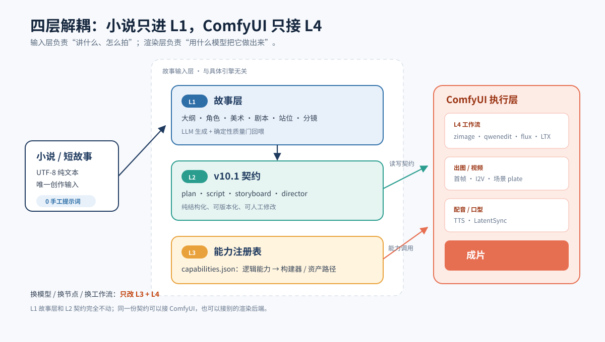
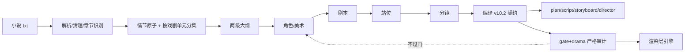
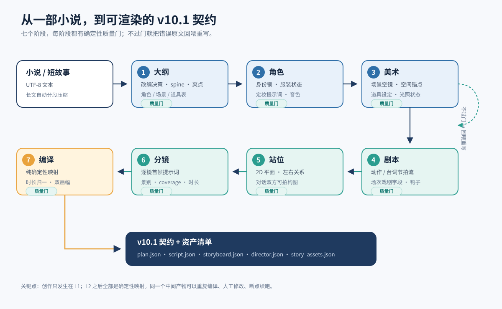
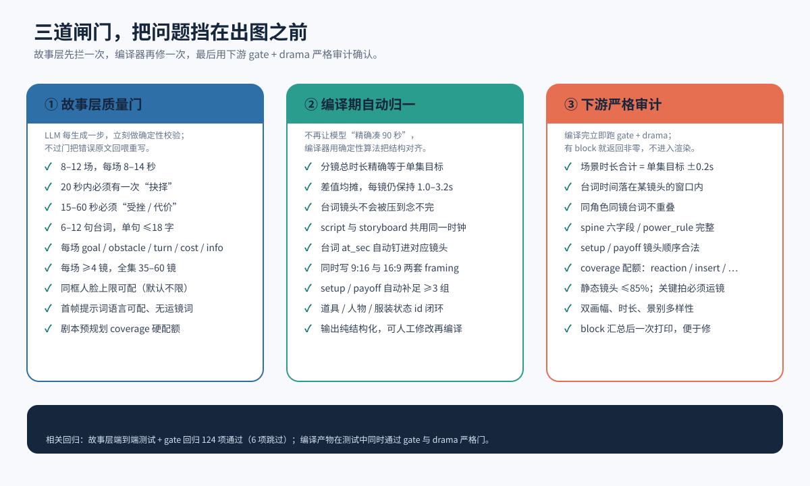

# 漫剧故事输入层 · Manju Story Input Layer

> **一部小说进去，一套可渲染的漫剧契约出来。**

> **版权声明 · Copyright**
>
> **Copyright (c) 2026 lenox-zeng. All Rights Reserved.**
>
> 本项目为**专有软件**，不是开源项目。仅允许通过 GitHub 浏览参考；未经作者书面许可，禁止复制、修改、改编、分发、商用或再发布。完整条款见 [LICENSE](LICENSE)。
>
> This is **proprietary software**, not open source. Viewing via GitHub is permitted for reference only. Copying, modification, adaptation, distribution, commercial use or re-publication requires prior written permission. See [LICENSE](LICENSE).
>
> 部分代码由 AI 辅助生成，已经过人工审阅与修改。


[English](./README.en.md) · [快速开始](#快速开始) · [两种使用方式](#两种使用方式) · [文档](#文档) · [许可证](LICENSE) · 版本 v2.0 / 输入契约 v10.3 / 输出契约 v10.2

Manju 是一个**小说 → 剧本 → 分镜 → 渲染契约**的自动化流水线。它把"写小说"与"操作 AI 模型"彻底分离：你只管把小说丢进来，它负责解析、压缩、分集、写剧本、做分镜，最终产出一份**纯结构化、与具体引擎无关**的渲染契约。下游无论用 ComfyUI、Seedance 还是别的引擎，都只消费这份契约。

项目提供**命令行**与**本地图形界面（Manju Studio）**两种入口，共用同一套流水线与产物；你可以按场景任选，也可以随时切换。

---

## 两种使用方式

| | 命令行 `story_cli` | Manju Studio |
|---|---|---|
| **适合** | 批量跑、服务器/CI、脚本化、需要全部参数 | 单人创作、逐镜修改、可视化审阅、边看边调 |
| **启动** | `python -m manju.story_cli input\my_story.txt --yes` | `.\scripts\studio.ps1` → `http://127.0.0.1:8092` |
| **生成** | 全部生成参数、范围续跑、严格门、`--resume` | 「生成」页选择小说/分集方式/范围，后台调用同一个 `story_cli` |
| **编辑** | 直接修改 `state/story/<小说名>/*.json` | 分镜逐镜编辑、资产/画风/世界观可视化编辑 |
| **发布** | 生成成功自动编译；改中间产物后重跑 `--resume` | 「发布契约」按钮，复用同一套编译与 gate/drama 审计 |
| **教程** | [`docs/小说输入层使用教程.md`](docs/小说输入层使用教程.md) | [`docs/Studio使用教程.md`](docs/Studio使用教程.md) |

> 两种方式产出的契约完全相同。Studio 只是 `story_cli` 的可视化前端，不是另一套流水线。

## 一张图看懂架构

本包实现 **L1 故事层 + L2 契约**（输入层）；**L3 能力注册表 / L4 执行层**属于完整联调包，不在本包内，但你产出的契约可以直接对接它们。



一句话价值：**L1 决定"讲什么、怎么拍"，L2 把它固化成可版本化的契约；渲染层只负责"用什么模型把它做出来"。**

---

## 为什么值得用

| 能力 | 说明 |
|---|---|
| **小说即输入，零手工提示词** | 只需要一部 UTF-8 小说；自动识别编码/章节、先清理广告网址与排版、再按情节单元分集、超长自动压缩 |
| **情节驱动分集** | 先切有序情节原子，由 LLM 按“目标→阻力→转折→代价→新问题”决定集数与每集 2–6 条 `must_show`（每条是讲完整的事件单元，关键短事件可独立成集）；`key_lines` 保证关键台词一字不改落拍（允许纯对话集）；剧本逐条对账，关键道具强制 insert 特写、每镜必须有运镜 |
| **确定性质量门** | 每次生成都跑硬门/软门校验，不过门就把错误原文回喂模型重写（默认 3 次） |
| **物理/剪辑连续性** | 逐镜声明 `state_out`，跨场跨集继承，确定性拦截跳切、越轴、瞬移、丢道具、服装回退 |
| **剧本侧专业优化** | 剧本质量与分镜衔接两手抓（忠实度评估、竖屏范式、拍级状态账本、R² 因果图、衔接 QC） |
| **对白稀疏叙事增强** | 台词密度低时自动下调台词预算、提高 reaction/insert；必要前情与内心写入结构化旁白（不做口型）；场间转场必须说明 match_cut / sound_bridge / action_bridge / time_jump / fade / dissolve 及 anchor，避免无动机硬切 |
| **与引擎彻底解耦** | 只产出 `plan/script/storyboard/director` 契约；换引擎不重写剧本 |
| **高杠杆人工审阅** | 大纲批准（阻塞）、质量门失败包、`--review` 分步审查，先审后跑 |
| **只依赖文本 API** | 默认 DeepSeek（OpenAI 兼容），不依赖本地 GPU / llama-server |

---

## 流水线总览





每个生成阶段都有**重写回喂**：模型输出结构合法但没过质量门时，错误原文连同上一次输出一起回喂，最多重写 `llm.story_gate_attempts` 次（默认 3）。

---

## 目录结构

```
manju-story-input-v2.0/
├── manju/
│   ├── story/                    # L1 故事层（16 个模块）
│   │   ├── ingest.py             解析/编码/章节回退
│   │   ├── episodes.py           自动/人工分集（章节/字数兜底）
│   │   ├── plot.py               情节原子 / 按戏剧单元分集 / 区间修复
│   │   ├── summarize.py          长篇压缩
│   │   ├── stages.py             两级大纲 / 角色 / 美术 / 剧本 / 站位 / 分镜生成（管线主体）
│   │   ├── prompts.py            阶段规则 / 系统提示词 / 输入 payload / 定向摘录（提示词层）
│   │   ├── repairs.py            质量门不过时的确定性本地修复（不回喂模型）
│   │   ├── engines.py            引擎能力档案（comfyui / seedance / jimeng 参数推荐值）
│   │   ├── models.py             Pydantic 数据模型
│   │   ├── validate.py           确定性质量门 + 剧本侧校验
│   │   ├── editorial.py          剪辑/连续性校验器
│   │   ├── continuity_map.py     跨集动线图
│   │   ├── continuity_qc.py      衔接 QC 面板
│   │   ├── causal.py             R² 因果图
│   │   ├── compile.py            v10.2 契约编译器
│   │   ├── review.py             大纲审批 / 失败包 / 人工审阅
│   │   └── ...（continuity.py / clean.py 等）
│   ├── story_cli.py              独立命令行入口
│   ├── studio.py                 Manju Studio 本地 Web 服务
│   ├── studio_ui.html            Studio 单页前端（无构建依赖）
│   ├── gate.py                   v10.2 跨文档契约审计
│   ├── drama.py                  戏剧结构 / 分镜审计
│   ├── llm.py                    OpenAI 兼容客户端 + JSON 修复重试
│   ├── report.py                 故事层报告
│   └── config.py / jsonio.py / tracing.py / schemas.py
├── tests/                        离线验收测试（18 个测试模块，243 passed / 6 skipped）
├── scripts/                      离线验收 / 产物审计 / 通过率 / PowerShell 启动
├── docs/                         命令行/Studio 教程 / 契约 / ComfyUI 对接指南 / 图文介绍 / 自检报告
│   └── assets/story-input/       架构、流水线、质量门等示意图
├── input/                        小说入口（纯净包不附样书；放入自己的 .txt）
├── state/                        运行时中间产物（自动生成，已被 git 忽略）
├── output/ logs/                 输出与日志（自动生成，已被 git 忽略）
├── VERSION                       2.0.0
├── MAINTENANCE.md                v2.0 活跃、v1.2 冻结的维护边界
├── CHANGELOG.md
├── .gitignore
├── config.example.json          可移植配置模板（无真实 Key）
├── PACKAGE_NOTES.md             纯净包范围、剔除项与自检结果
└── requirements.txt
```

---

## 快速开始

### 1. 安装（Python 3.11+）

```powershell
python -m venv .venv
.\.venv\Scripts\python.exe -m pip install -r requirements.txt
```

Linux/macOS：

```bash
python3 -m venv .venv
.venv/bin/python -m pip install -r requirements.txt
```

装完先做一次只读自检（不读小说、不调模型）：

```powershell
.\scripts\run.ps1 --doctor
```

```bash
MANJU_ROOT="$PWD" python -m manju.story_cli --doctor
```

### 2. 配置文本模型（DeepSeek）

需要一个 OpenAI 兼容接口，默认 **DeepSeek**（`https://api.deepseek.com/v1`）。纯净包不含 `config.json`，首次使用先复制模板：

```powershell
Copy-Item config.example.json config.json
```

然后在 `config.json` 的 `llm` 段配置 `provider / base_url / model`；API Key **优先用环境变量**：

```powershell
# 当前 PowerShell 会话
$env:DEEPSEEK_API_KEY = "<你的 Key>"

# 或写入当前用户环境变量，之后新开终端都生效
[Environment]::SetEnvironmentVariable("DEEPSEEK_API_KEY", "<你的 Key>", "User")
```

| 配置 | 值 |
|---|---|
| 环境变量 | `DEEPSEEK_API_KEY`（也支持 `MANJU_LLM_API_KEY` / `OPENAI_API_KEY`） |
| `base_url` | `https://api.deepseek.com/v1` |
| `model` | `deepseek-v4-pro`（更强）/ `deepseek-flash`（更快，默认） |

> ⚠️ **不要把真实 Key 写进 `config.json` 或提交进 git**。`config.json` 已在 `.gitignore`，但明文落盘仍有被备份、同步、截图带走的风险。Studio 配置页输入的 Key 只保存在 Studio 进程内存中，重启后失效；长期使用请设环境变量。`--doctor` 会显示 Key 来源，并提示迁移旧配置里的明文 Key。
>
> 如果 Key 曾经出现在终端、日志或聊天里，请先在服务商控制台**吊销并重新生成**，再配置新 Key。

### 3. 方式 A：命令行生成

把小说文本放进 `input/`（纯净包不附样书）。先只跑前 2 集，避免一次消耗整本 token：

```powershell
.\scripts\run.ps1 input\my_story.txt --to-episode 2 --yes
# 等价的直接入口
.\.venv\Scripts\python.exe -m manju.story_cli input\my_story.txt --to-episode 2 --yes
```

确认链路正常后跑整本：

```powershell
python -m manju.story_cli input\my_story.txt --yes
```

输出**按小说名分目录**，多部小说互不干扰。生成先写**临时工作目录** `state/story/.work_<小说名>/` 与 `input/.work_<小说名>/external/`，只有**完整成功**（质量门 + 编译 + 审计全过）才固化到最终目录 `state/story/<小说名>/` 与 `input/<小说名>/`（完成标记 `_completed.json` 写在 `state/story/<小说名>/`，随后清空临时）；`--clean` 只清临时、**已成功的成品永不被删**：

```
state/story/<小说名>/cleaned.txt       # 预处理后的正文（仅在内容有变化时写）
state/story/<小说名>/cleanup_report.json # 删了哪些行、样例、乱码/误删告警
state/story/<小说名>/bible.json       # 全局圣经（角色/美术/剧本/分镜分别是 cast/art/script_epNN/board_epNN）
state/story/<小说名>/outline.json
state/story/<小说名>/cast.json
input/<小说名>/external/plan.json      # 全剧圣经：角色、身份锁、视觉圣经、集数、画幅
input/<小说名>/external/ep01/script.json  # 本集剧本 + 场次字段 + 台词时间轴 + 旁白/转场
input/<小说名>/external/ep01/director.json # spine / power_rule / setup-payoff / coverage
input/<小说名>/ep01/storyboard.json    # 逐镜首帧提示词、景别、运镜、时长、双画幅、旁白/转场
input/<小说名>/story_assets.json       # 定妆 / 场景 plate / 道具 清单
state/report/index.html                # 故事层报告（人工审查）
```

常用参数：

```powershell
# 只看章节表（不调模型）
python -m manju.story_cli input\my_story.txt --list-chapters
# 解析 + 情节原子预演（不调 LLM、不写盘）
python -m manju.story_cli input\my_story.txt --dry-run --yes
# 默认情节分集（LLM 按戏剧单元决定集数）；下面回到旧的章节/字数分集
python -m manju.story_cli input\my_story.txt --no-plot-mode --chapters-per-episode 3
# 指定总集数（与 --chapters-per-episode 互斥）/ 每集字数 / 范围
python -m manju.story_cli input\my_story.txt --episodes 3 --duration 120
python -m manju.story_cli input\my_story.txt --from-episode 5 --to-episode 20
# 关闭预处理（默认会清理广告/网址、统一换行与多余空格）
python -m manju.story_cli input\my_story.txt --no-cleanup
# 先审大纲 / 角色 / 美术，批准后继续
python -m manju.story_cli input\my_story.txt --review
python -m manju.story_cli input\my_story.txt --review --resume
# 质量门失败：写失败包并交互等待修复
python -m manju.story_cli input\my_story.txt --on-gate-fail ask
# 只清除当前小说的临时工作目录（.work_<小说名>）后从头生成；已成功的成品保留
python -m manju.story_cli input\my_story.txt --clean --yes
```

完整用法见 `docs/小说输入层使用教程.md`；图文介绍见 `docs/故事输入层介绍_图文版.md`。

### 4. 方式 B：Manju Studio

```powershell
.\scripts\studio.ps1
# 浏览器打开 http://127.0.0.1:8092
```

Studio 提供「生成 → 分集/分镜 → 资产 → 画风/世界观 → 发布契约」的完整工作流：

1. 「生成」页选择小说、分集方式与本次生成范围，点 **开始生成**；
2. 「分集 · 分镜」逐镜查看/修改，改完点 **保存该镜**；
3. 「角色 · 场景 · 道具」「画风 · 世界观」编辑资产与设定；
4. 页面底部发布条出现后，点 **重新编译契约** 写入 `input/`。

产物与方式 A **完全相同**。详细说明见 [`docs/Studio使用教程.md`](docs/Studio使用教程.md)。

> **随时切换**：Studio 生成的中间产物，命令行加 `--resume` 可直接复用；命令行生成的产物，Studio 也能直接打开查看和修改。

> 纯净包不附带样书；放进 `input/` 的小说默认被 `.gitignore` 忽略，
> 不会被误传到 GitHub。

---

## 产出契约（v10.2）

本包**只负责"小说 → 契约"**，下游读取：

| 文件 | 用途 |
|---|---|
| `plan.json` | 角色身份锁、视觉圣经、集数、画幅 |
| `script.json` | 剧本、场次戏剧字段、台词绝对时间轴、场级旁白与场间转场 |
| `storyboard.json` | 逐镜首帧提示词、景别、运镜、时长、双画幅 framing、镜头旁白与首镜转场 |
| `director.json` | spine、power_rule、setup/payoff、coverage 与切点 |

契约版本 **v10.2**。同一份契约可交给 ComfyUI，也可交给未来的其他渲染后端。字段定义与校验规则见 `docs/漫剧文本输入契约_v10.2.md`；**下游实现层如何读取、字幕/TTS/口型/转场怎么接，见 [`docs/ComfyUI对接指南.md`](docs/ComfyUI对接指南.md)**。渲染适配器、能力注册表与工作流属**完整联调包**，不在本包内。

---

## 质量门

每次生成都会跑确定性校验，不过门就把错误原文回喂重写：

**硬门（始终报错）**

- ID 与引用闭环，剧本/站位/分镜场次与人物一致
- 单镜时长默认 1–3.2 秒（`story.max_shot_seconds` 可配，引擎档案会按引擎放宽）；每场切镜合计 = 剧本场时长（±0.3 秒）；全集 = 目标（±15%）
- 对白只允许画内；speaker 必须在本场；单句 ≤`story.max_line_chars`（默认 18 字，引擎档案 comfyui=20 / seedance=40）；台词装得进所在切镜
- 必要的前情/规则/时间跳跃与角色内心，写入 `scene.narration`（`exposition` / `inner`），叠在动作拍上、不做口型；旁白不得复述可见动作
- 第 2 场起必须能说清 `transition_in`（match_cut / sound_bridge / action_bridge / time_jump / fade / dissolve）；bridge 类必须有共享 anchor，避免无动机硬切
- 每镜必须有运镜：Static Shot 占比 ≤40%（`story.camera_motion=limited` 时 ≤60%），关键拍（key_prop/highlight/climax）强制非 Static；prompt_en/motion 必须写运镜与动作，提示词过短（<40 字符）会告警
- 分集层 `key_lines`（1–4 句）是必须一字不改落拍的关键台词；剧本层逐句对账，允许纯对话集
- 节拍连续覆盖、不重不漏；最后一场必须是结尾钩子；每个 cut 必须有 `state_out`（由剧本拍 + EDL 确定性推导）

**软门（默认 warning，`--strict` 恢复为错误）**

- 一集 1–4 个完整戏剧单元（场数由内容决定，允许纯对话集）；台词句数不设硬上限（`suggest_lines` 仅参考）；20 秒内有一次抉择；15–60 秒内有受挫/代价且 `cost` 非空；连续 3 集至少 1 个爽点
- **对白稀疏自动模式**：原文引号台词密度低时，只给较低的台词参考值（不设硬上限），reaction/insert coverage 提高；关键对话由 `key_lines` 机制保证一字不改保留，密集对话（含纯对话集）不再被压减



编译期会：总时长精确归一、保持每镜在配置的时长区间内、保证台词念得完、同时写 9:16 与 16:9、自动补足 setup/payoff。编译后再跑 `gate` + `drama` 严格审计，有 block 返回非零，不进入渲染。

### 引擎能力：默认通用，按需收紧

渲染器/口型引擎做不到的事，不应该写死成整个项目的规则。以下能力项都在 `config.json` 里配置，**不配置即通用默认**：

| 配置键 | 默认 | 说明 |
|---|---|---|
| `story.engine` | `""`（通用） | 引擎档案：`""` / `"comfyui"` / `"seedance"` / `"jimeng"`。选定后未显式配置的引擎能力字段取 `manju/story/engines.py` 推荐值（如 seedance：单镜 ≤8s、单句 ≤40 字、同框 ≤3 脸、full 运镜；comfyui：单镜 ≤4s、单句 ≤20 字、同框 ≤1 脸、limited 运镜）。显式配置优先 |
| `story.camera_motion` | `"full"` | 运镜能力：`full`=每镜必须有运镜，静态 ≤40%，推拉摇移跟环绕均可；`limited`=静态 ≤60%，仅轻度运镜（Push In/Tilt/Pedestal），禁大幅运动（局部模型防形变）。由 `story.engine` 档案决定，可显式覆盖 |
| `story.max_faces_per_shot` | `null`（不限） | 每个画幅最多几张可锁正脸；单参考图 PuLID 可设 `1`，多人引擎可设 `2/3` |
| `story.max_lines_per_shot` | `null`（不限） | 每镜最多几句台词；单口型引擎可设 `1` |
| `story.min_shot_seconds` | `1.0` | 单镜时长下限；极短台词也按此下限计时 |
| `story.max_shot_seconds` | `3.2` | 单镜时长上限（≤30）；seedance 档案给 8.0，comfyui 给 4.0 |
| `story.max_segment_seconds` | `15.0` | 一个分镜段的最大时长 |
| `story.action_seconds` | `2.5` | 一个纯动作拍的基准时长（秒） |
| `story.tolerance` | `0.15` | 单集总时长允许偏差（±15%） |
| `story.max_line_chars` | `18` | 单句台词汉字上限；下游 drama 审计读取同一值。seedance 档案给 40（关键台词可完整成句） |
| `story.no_face_chars` | `[]` | 声明为“没有可锁正脸”的角色 id；同框多脸计数时排除 |
| `story.prompt_language` | `"en"` | 角色定妆 / 场景美术 / 分镜首帧的提示词语言：`en` / `zh` / `any` |
| `story.chars_per_second` | `4.5` | 语速基线（中文 4.5 字/秒） |
| `story.narration_mode` | `"auto"` | 旁白策略：`auto` 按原文对白密度自动补；`off` 禁止写旁白（写入即 block）；`on` 要求本集有旁白 |
| `story.narration_max_exposition` | `2` | 每集解释性旁白上限（防止有声书化） |
| `story.narration_max_inner` | `3` | 每集内心独白上限 |
| `story.transition_mode` | `"auto"` | 场间转场检查：`auto` / `on` 时第 2 场起缺 `transition_in` 报错，bridge 类缺 `anchor` 也报错；`off` 关闭强制（已写出的非法转场仍校验，缺 anchor 降为 warning） |
| `llm.thinking` | `"low"` | 思考模式：`auto` / `disabled` / `low` / `medium` / `high`；机械阶段可关思考提速度 |
| `llm.thinking_by_stage` | `{}` | 按阶段名前缀覆盖思考档位，如 `{"novel-script":"high","novel-board-prompts":"disabled"}` |
| `llm.stream` | `true` | 流式输出；空闲超过 `stream_idle_timeout_sec`（默认 180s）无 chunk 才断开 |
| `llm.prompt_parallel` | `4` | 分镜提示词跨场并行展开的并发数 |

未配置人脸与台词句数时，多人同框、多句同镜都**不会**被质量门拦截；只有显式配置上限后才按该能力收紧。

输入层不提供“分镜形象提示模式”（原 `story.prompt_identity_mode`）。分镜 `prompt_en` 固定只写动作/场景/表演；角色身份通过 `ref_characters`、表情/服装状态以及 `story_assets.json` 的 `identity_prompt` / `identity_anchor` 输出，由实现层按自己的图生视频、锁脸或纯文本方案决定是否注入。
思考模式在端点不支持 `thinking` / `reasoning_effort` 参数时会自动降级；流式不受支持时自动回退非流式，均不会因能力差异整批失败。

---

## 连续性：跨镜 / 跨场 / 跨集

每个 cut 声明 `state_out`（位置、朝向、姿态、服装、道具、伤势）。分镜先按场顺序排 EDL（切点/景别/人物/状态），本场 `state_in` 继承上一场终态；视觉提示词随后跨场并行展开。跨集 `state_out` → 下一集 `state_in`。确定性检查：

- 位置跳变 / 瞬移
- 服装回退、道具转移/消失
- 伤势回退
- 越轴、视线不接、景别跳变

范围生成时 `--from-episode N`（N>1）会读取 `state/story/<小说名>/board_ep{N-1}.json` 继承终态。

---

## 剧本侧：衔接 + 质量（P0–P2 已合回）

在剧本这一上游环节上，本包做了**分镜衔接**与**剧本质量**两套专业优化（见 `docs/漫剧文本输入契约_v10.2.md`）：

| 层 | 要点 |
|---|---|
| **衔接（P0/P1）** | 动作拍方位约束、拍级状态账本前移、beat→镜头建议、跨集开场状态继承、同地点连续场合并校验、心理句可视性拦截 |
| **质量（P0）** | 改编忠实度、竖屏范式检查、台词风格一致性门、站位-剧本联合校验 |
| **深化（P2）** | R² 两遍生成因果图（去环）、场景重构决策记录、分层 Look Back、衔接 QC 面板 |

---

## 质量审计与通过率

v2.0 把“能不能稳定跑通”做成可复现的脚本，而不是口头结论：

```powershell
# 1) 离线验收：编译 + 243 个测试 + CLI 冒烟（有样书时再做情节 dry-run；不调 API）
python scripts\verify_offline.py

# 2) 审计一次产物：must_show 覆盖 / causal_from / 关键道具特写 / 关键拍运镜
python scripts\audit_run.py --novel my_story

# 3) 离线查看最近通过率；--audit-existing 可审计已有成品
python scripts\pass_rate.py
python scripts\pass_rate.py --novel my_story --audit-existing

# 4) 真实通过率（显式 --live 才会调用 API，会产生费用）
python scripts\pass_rate.py --live --runs 3 --input input\my_story.txt --to-episode 2

# 5) 契约一致性：schemas.py 字段 vs 契约文档（报告式；--strict 时契约层
#    有字段未在文档提及则返回 1，适合接 CI）
python scripts\check_contract_sync.py
```

每次 live 运行写独立的 `state/pass_rate/run_*/`，不覆盖 `input/<小说>/` 成品。
**当前 v2.0 尚未做 live 端到端测量，因此不宣称 ≥90% 通过率；** 先用脚本量出来，再据此修。旧版产物没有 `must_show/emphasis` 字段时，审计会标 `SKIP` 并提示重跑，不会误报。

---

## 自检

不调模型、不碰 GPU：

```powershell
.\.venv\Scripts\python.exe -m pytest tests -q
.\.venv\Scripts\python.exe -m compileall -q manju scripts
```

预期：**243 passed / 6 skipped**（6 个 skipped 是依赖完整流水线 `manju.cli` 的集成测试，本输入层包仅提供精简的 `manju.story_cli`）。

覆盖：解析/编码/章节回退 → 自动分集/人工分集 → 长篇压缩/截断 → 两级大纲 → 硬/软门 → 连续性/跨集交接 → 大纲审批/失败包 → 编译 → gate/drama → 剧本侧衔接/质量 → 报告/WebP 兜底。

---

## 适用边界

- 同框人脸数默认不限；若你的渲染引擎只能锁一张脸（如单参考图 PuLID），在 `config.json` 的 `story.max_faces_per_shot` 设为 `1`，多人同框再拆镜或使用背影/剪影
- 创作质量依赖源文本与文本模型
- 超长小说会分卷摘要，细节可能损失；最多压缩 60 卷，超限显式 `truncated`
- 报告截图依赖本机 Chrome/Edge；缺失时用 Pillow 占位图并提示
- 复杂连续动作由下游视频模型能力决定
- 本包不启动/停止 ComfyUI，也不管理显存

---

## 交付给下游实现层

**契约是唯一标准，平台指南只做该平台的映射。** 交接时只给三样：

| 交付物 | 作用 |
|---|---|
| [`docs/漫剧文本输入契约_v10.2.md`](docs/漫剧文本输入契约_v10.2.md) | 唯一契约：字段语义、校验规则、版本规则；平台无关 |
| [`docs/ComfyUI对接指南.md`](docs/ComfyUI对接指南.md) | ComfyUI 平台适配：读取顺序、字段映射、旁白/转场、验收 |
| `input/<小说名>/` | 一份完整样例，供下游对照验收（纯净包不含生成结果，需单独提供） |

- 新增 Seedance 或其他平台时，只新增一份同结构的平台指南，**契约不动**。
- 平台指南不复制契约字段表，不定义新字段，不写校验规则。
- 不交付 `manju/schemas.py` / `gate.py` / `drama.py`：它们是输入层实现，不是接口。

---

## 文档

| 文档 | 说明 |
|---|---|
| [`docs/小说输入层使用教程.md`](docs/小说输入层使用教程.md) | **命令行教程**：安装、参数、分集、续跑、人工审阅、产物 |
| [`docs/Studio使用教程.md`](docs/Studio使用教程.md) | **Studio 教程**：启动、生成、逐镜编辑、资产/画风、发布契约、LLM 日志 |
| [`docs/漫剧文本输入契约_v10.2.md`](docs/漫剧文本输入契约_v10.2.md) | **唯一契约**：字段定义、校验规则、版本规则；平台无关 |
| [`docs/ComfyUI对接指南.md`](docs/ComfyUI对接指南.md) | **ComfyUI 平台适配**：读取顺序、字段映射、字幕/TTS/口型/旁白/转场、验收；不复制契约 |
| [`docs/故事输入层介绍_图文版.md`](docs/故事输入层介绍_图文版.md) | 图文架构与设计思路 |
| [`docs/自检报告.md`](docs/自检报告.md) | 本包自检结果 |
| [`docs/live-baseline.md`](docs/live-baseline.md) | live 端到端通过率基线的口径与执行步骤（当前未执行） |
| [`docs/v2.0改动说明.md`](docs/v2.0改动说明.md) | v2.0 做了什么、没做什么 |
| [`PACKAGE_NOTES.md`](PACKAGE_NOTES.md) | 纯净包范围、剔除项与自检结果 |
| [`MAINTENANCE.md`](MAINTENANCE.md) | v2.0 / v1.2 的维护边界 |

---

## 参与贡献

> 本项目为专有软件，不接受未经作者书面同意的外部代码贡献。以下检查供作者维护和已获授权的合作者使用。

- 提交前请先跑离线验收：`python scripts\verify_offline.py`（预期 **243 passed / 6 skipped**）。
- 改了 `manju/schemas.py` 或契约文档后，请跑 `python scripts\check_contract_sync.py` 核对字段覆盖。
- 不要提交 `config.json`、真实 API Key、`state/`、`input/` 下的私有小说；这些路径已被 `.gitignore` 忽略。
- 新增或修改生成规则时，请同时补测试，并在 `CHANGELOG.md` 记录行为变化。
- Bug 报告请附上：小说样书/片段、运行命令、`state/llm_trace.jsonl` 中相关阶段记录（注意先脱敏）。

## 许可证

本项目采用 **专有许可（All Rights Reserved）**，**不是开源项目**。仅允许通过 GitHub 浏览参考；未经作者书面许可，禁止复制、修改、改编、分发、商用或再发布。完整法律条款见 [LICENSE](LICENSE)。

本项目不接受未经事先书面同意的代码贡献；提交 Issue 或 Pull Request 不代表获得任何授权。部分代码由 AI 辅助生成，已经过人工审阅与修改。第三方组件（如有）仍受其各自许可证约束。
