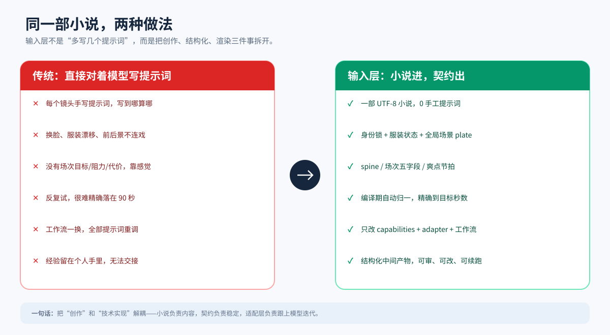
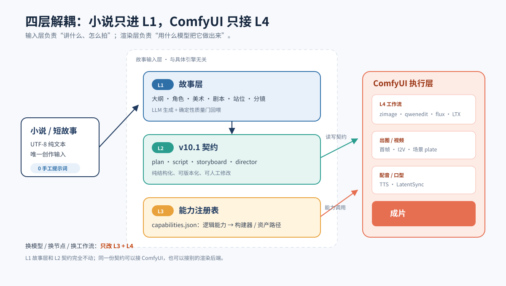
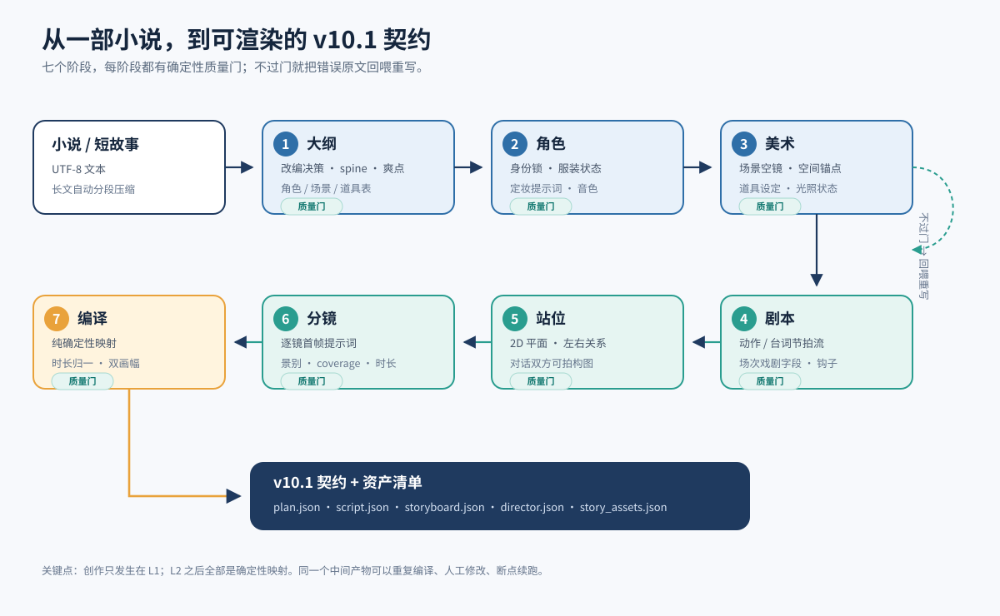
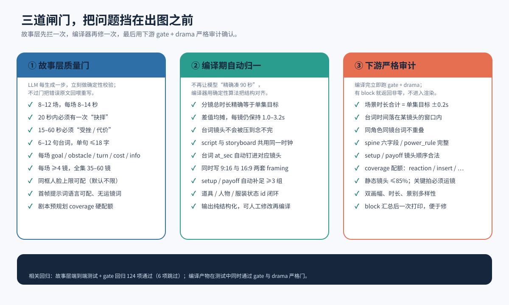
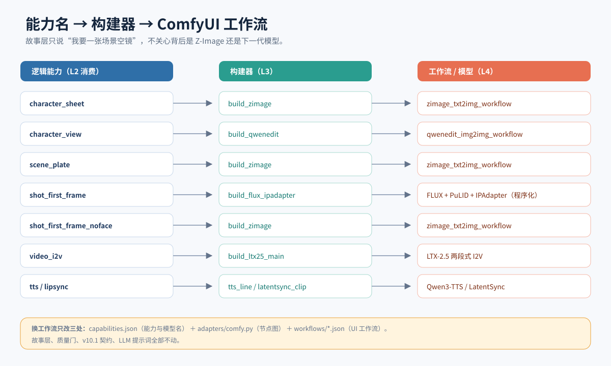

# 故事输入层介绍（图文版）

> **一部小说进去，一套可渲染的漫剧契约出来。**
>
> 不需要手工写分镜提示词，不需要先学 ComfyUI 节点，也不需要在换模型时重做整条创作链。



---

## 0. 30 秒看懂

```powershell
python -m manju.story_cli input\my_story.txt --yes
```

默认自动解析编码、清理广告/网址/排版，再按**戏剧单元**分集：LLM 通读有序情节原子，
决定集数与每集 2–6 条必拍事件（不再按 2 章或 9000 字硬切；超过 12 集需确认或 `--yes`）。输出：

```
input/<小说名>/external/plan.json
input/<小说名>/external/ep01/script.json
input/<小说名>/external/ep01/director.json
input/<小说名>/ep01/storyboard.json
input/<小说名>/story_assets.json
input/<小说名>/prompts/story.md
state/report/index.html
state/report/ep01.html
state/report/report.webp
```

前 5 个是渲染层需要的全部业务输入，提示词汇总供人工核对，`state/report/` 是故事层可视化报告。之后交给现有 ComfyUI 流水线出图、出视频、配音、对口型即可（渲染流水线不在本包内）。

| 维度 | 数字 |
|---|---|
| 用户创作输入 | **1 个文本文件** |
| 输入处理 | **解析 / 压缩 / 分集 3 步**（确定性，不调模型） |
| 创作阶段 | **7 步**（圣经 → 分集梗概 → 角色 → 美术 → 剧本 → 站位 → 分镜） |
| 解耦层级 | **4 层** |
| 确定性质量闸门 | **3 道**（生成门 / 编译归一 / 下游审计） |
| 手工写提示词 | **0 条** |
| 90 秒单集分镜 | **35–60 镜**，单镜默认 1.0–3.2 秒（可配） |

---

## 1. 它解决的核心问题

传统“小说改编漫剧”最容易断在三个地方：

1. **创作与技术混在一起**：编剧、分镜、提示词、工作流全绑在一个人身上，换模型就全部重来。
2. **人物前后不一致**：每个镜头单独写提示词，脸、发型、服装、场景都可能漂移。
3. **问题发现太晚**：剧本结构不对、时长不对、台词念不完，往往到出图甚至出片才发现，返工成本极高。

输入层把这三件事拆开：

- **创作**交给 L1 故事层；
- **稳定**交给 L2 结构化契约 + 确定性质量门；
- **技术**交给 L3 能力注册表 + L4 ComfyUI 工作流。

---

## 2. 核心设计：四层解耦



### L1 故事层

只做创作和结构化：

- 小说大纲与改编决策
- 角色身份锁、服装状态、音色
- 场景空镜、空间锚点、道具状态
- 动作/台词节拍流剧本
- 2D 平面站位
- 逐镜首帧提示词与 coverage

产出的是**故事事实**，不是 ComfyUI 节点参数。

### L2 v10.2 契约

把故事层映射成渲染层认识的固定结构：

| 文件 | 作用 |
|---|---|
| `plan.json` | 全剧圣经：角色、身份锁、视觉圣经、集数、画幅 |
| `script.json` | 本集剧本、场次戏剧字段、台词绝对时间轴 |
| `storyboard.json` | 每镜首帧提示词、景别、运镜、时长、双画幅 framing |
| `director.json` | spine、power_rule、setup/payoff、coverage 与切点信息 |

**关键点：L2 不依赖 ComfyUI。** 同一份契约可以交给 ComfyUI，也可以交给未来的其他渲染后端。

### L3 能力注册表（完整联调包，不在本包内）

完整联调包用能力注册表把“我要什么”翻译成“用什么做”：

```text
character_sheet   → build_zimage        → zimage_txt2img_workflow
scene_plate       → build_zimage        → zimage_txt2img_workflow
character_view    → build_qwenedit      → qwenedit_img2img_workflow
shot_first_frame  → build_flux_ipadapter→ FLUX + PuLID + IPAdapter
video_i2v         → build_ltx25_main    → LTX-2.5
tts               → tts_line            → Qwen3-TTS
lipsync           → latentsync_clip     → LatentSync
```

### L4 ComfyUI 工作流（完整联调包，不在本包内）

真正的 UI 工作流、节点、模型名、显存调度都在这一层。工作流升级时，只改 L3 + L4。

> 本仓库是**纯输入层**：只包含 L1 故事层与 L2 契约编译/审计，不包含 L3/L4 的代码与工作流。

---

## 3. 一条流水线：输入处理 + 七个创作阶段



### 输入处理（不调用模型）

| 步骤 | 规则 | 产出 |
|---|---|---|
| 解析 | 自动识别 UTF-8 / BOM / UTF-16 / GBK；识 `第X章/回/节/卷/部`、楔子、序章、尾声、番外、`Chapter N` | 章节表 |
| 回退 | 无章节时按 20000 字切段、相邻 500 字重叠，尽量在换行处收尾 | 切段表 |
| 压缩 | ≤30000 字跳过；否则 5 章/卷 → 卷事件摘要 → ≤30000 字全书法典；最多 60 卷，超限显式 `truncated` | 内存法典 + warnings（无单独文件） |
| 分集 | 情节原子（~2400 字）→ LLM 按戏剧单元决定集数与 4–6 条 must_show（最少 2）；`--to-episode N` 只设计/生成前 N 集；超 12 集需确认或 `--yes` | `ep_src_NNN.txt` |

### 创作阶段

| 阶段 | 输入 | 产出 | 质量门关注 |
|---|---|---|---|
| ① 全局圣经 | 全书法典 | 改编决策、spine、角色/场景/道具表、爽点 | ID 闭环、爽点分布、主场景占比 |
| ② 分集梗概 | 圣经 + 每集切片 + series_design | 每集 synopsis/hook/cliff + must_show/key_props（情节模式每批 ≤3 集） | 集号完整、引用闭环、必拍事件可落地 |
| ③ 角色 | 圣经 + 分集梗概 | 身份锁、服装状态、定妆提示词、音色 | 角色可区分、服装状态完整 |
| ④ 美术 | 圣经 + 角色 | 场景空镜、空间锚点、光照、道具状态 | 空景、提示词语言、道具尺度 |
| ⑤ 剧本 | 本集切片 + 前后集梗概 + 角色/美术 | 动作/台词节拍流、场次五字段、钩子 | 硬门 + 软门（见第 4 节） |
| ⑥ 站位 | 本集剧本 + 场景 | 2D 平面、人物位置/朝向/姿态 | 覆盖每个角色、对话左右关系 |
| ⑦ 分镜 | 本集剧本 + 站位 + 美术 | 逐镜提示词、景别、coverage、时长、`state_out` | 单镜时长、节拍连续、可选同框人脸上限、连续性 |
| ⑧ 编译 | 全部故事层产物 | v10.2 契约 + 资产清单 | 时长归一、双画幅、下游 gate/drama |

每个阶段都有**重写回喂**：模型输出结构合法但没过质量门时，错误原文会连同上一次输出一起回喂，最多重写 `llm.story_gate_attempts` 次（默认 3）。

剧本/站位/分镜**只使用本集切片 + 前后集梗概**，不再把全书开头 `source[:4000]` 塞给每一集。单集切片超长时按 must_show/key_props **定向摘录**：关键事件所在段落必进上下文，再补头尾；中段省略会显式标记。

---

## 4. 为什么它能稳定：三道闸门



### 第一道：故事层生成时

**硬门（始终报错）**

- ID 与引用闭环，剧本/站位/分镜场次与人物一致；
- 单镜默认 1–3.2 秒（可按引擎配置）；每场切镜合计 = 剧本场时长（±0.3 秒）；全集 = 目标（±15%）；
- 对白只允许画内；speaker 必须在本场；单句默认 ≤18 个汉字（可配，下游 drama 审计同值）；台词装得进所在切镜；
- 必要的前情/规则与角色内心写入结构化 `scene.narration`，叠在动作拍上、不做口型；旁白不复述可见动作；
- 第 2 场起必须声明 `transition_in`，bridge 类（match_cut / sound_bridge / action_bridge）必须有共享 anchor；
- 同框人脸上限默认不限；单参考图和口型引擎可在 config 里分别设为 1；
- 角色/场景/分镜提示词语言可配（默认英文）；禁止运镜词与画风词；
- 最后一场必须是“结尾钩子”，`hook_beat` 必须在前 3 拍内；
- 每镜必须声明 `state_out`。

**软门（默认只记 warning，`--strict` 恢复为错误）**

- 5–8 场（90 秒；场次过多会变成每场一个跳切）；
- 6–12 句台词；
- 20 秒内必须有一次“抉择”；
- 15–60 秒必须有“受挫 / 代价”，且 `cost` 非空；
- 连续 3 集至少 1 个爽点。

### 第二道：编译期自动归一

LLM 很难精确写出 90.00 秒。编译器会：

- 把分镜总时长**精确归一到单集目标**；
- 差值均摊到各镜，同时保持每镜在配置的时长区间内；
- 有台词的镜头不会被压到念不完；
- `script` 与 `storyboard` 共用同一套时钟；
- 同时写 `9:16` 与 `16:9` 两套 framing；
- 自动补足 `setup / payoff` 至少 3 组。

结果是：**故事层允许 ±15% 的生成误差，交付给下游的契约是精确的。**

### 第三道：编译后严格审计

编译完成立即跑：

- `gate`：场景合计 = 单集目标 ±0.2s、台词落在镜头窗口、同镜台词不重叠、双画幅、时长/景别多样性；
- `drama`：spine 六字段、power_rule、setup/payoff 顺序、coverage 配额、静态镜头占比。

有 block 就打印完整报告并返回非零退出码，**不会带着错误结构进入渲染**。

---

## 5. 对 ComfyUI 友好：换模型不用重写故事



输入层不直接拼 ComfyUI 节点图，而是只声明逻辑能力：

```text
"我需要一张场景空镜"
"我需要一张带角色身份锁的首帧"
"我需要把首帧变成 5 秒视频"
```

完整联调包的 L3 适配层负责把能力名翻译成当前 ComfyUI 的 API 图。替换工作流只需要三步：

1. 在 ComfyUI 里搭好新工作流，导出 **UI 格式**；
2. 放到 `workflows/<name>.json`；
3. 更新能力注册表与适配器。

这些文件属于**完整联调包**，不在本仓库内。故事层、质量门、v10.2 契约、LLM 提示词**全部不动**。

这也意味着：

- 今天用 Z-Image，明天换新一代模型，不需要重写整部剧；
- 同一份契约可以复用于不同分辨率/不同引擎；
- 工作流出问题时，排查范围被限制在 L3/L4。

---

## 连续性与角色一致性（v1.1 新增）

### 每个切镜都声明状态

```json
"state_out": {
  "where": {"C1": "north"},
  "facing": {"C1": "south"},
  "posture": {"C1": "standing"},
  "wardrobe": {"C1": "C1-default"},
  "props": {"P1": "C1"},
  "injuries": {"C1": "left arm bandaged"}
}
```

分镜按场顺序生成：本场 `state_in` = 上一场终态，输入最近两镜；跨集 `state_out` → 下一集 `state_in`。
确定性检查位置跳变、服装回退、道具转移/消失、伤势回退、越轴/180°、视线不接、景别跳变。

### 角色资产不是“可选装饰”

```
assets/characters/<C1>/identity.png
assets/characters/<C1>/angles/{three_quarter,side_left,side_right,back,low_angle,high_angle}.png
assets/characters/<C1>/expressions/{neutral,smile,anger,sadness,fear,surprise,determination}.png
assets/wardrobe/<state_id>/plate.png
```

- 6 视角 + 7 表情 + 每套服装 1 张，全部由 identity 派生；
- 参考图按景别/朝向/俯仰/情绪**语义选择**，同框每人先保一张 identity；
- 缺任何一张都会中止渲染，避免静默退化成纯文字换脸；
- 可选 DINOv2 / CLIP 人脸相似度 QA，阈值需用本片正负样本校准。

## 可视化报告

编译通过后默认写 `state/report/`：

- `index.html`：KPI、时长节奏带、集卡、角色卡与出场矩阵、场景/道具卡、门禁结果；
- `epNN.html`：逐镜首帧、台词、连续性（`state_out`）、门禁；
- `report.webp`：无头 Chrome/Edge 截图；无浏览器时用 Pillow 占位图并显式提示；
- 长篇每 40 集一季折叠，已有剧本的集仍有独立页面；
- `--no-report` 可关闭，报告失败只 WARN，不影响已编译契约。

---

## 6. 十个突出优点

### 1. 唯一创作输入

用户只需要提供小说文本。大纲、角色、美术、剧本、站位、分镜全部自动生成，不需要先学提示词工程。

### 2. 人物一致性有结构保障

- 角色 `identity_lock` 锁定脸型、发型、瞳色、体型；
- 服装按状态管理（默认、受伤、湿身、换装），不写进“永久身份”；
- 同框正脸数由引擎能力配置决定（默认不限；单参考图引擎设 1 时优先拆成单人反打/过肩/背影）；
- 场景使用全局共享 plate，跨集复用。

### 3. 前后镜头有关联

- 每场先有目标、阻力、转折、代价、信息；
- `setup / payoff` 在编译期从道具出现位置自动推导；
- 分镜节拍必须连续覆盖剧本，不能跳拍；
- 台词 `at_sec` 钉在具体镜头窗口内，口型与画面有依据。

### 4. 剧本是“可拍的”，不是“好看的”

- 动作节拍要求具体动作链，禁止心理活动；
- 动作描述里禁止引号台词；
- 对白只允许画内，speaker 必须在本场出场；
- 台词是动作的延伸，不是解释；
- 需要解释前情或呈现内心时，不用 VO 台词，而是写入结构化 `scene.narration`：`exposition` 只解释画面看不出的信息，`inner` 用角色 id 做 speaker，叠在动作拍上、不做口型；
- 场与场之间必须有可命名的转场动机（`transition_in` + anchor），不能无理由硬切。

### 5. 时长和节奏可控

- 90 秒集生成 35–60 镜；
- **剧本层先规划镜头预算**：一镜一拍，剧本拍数必须 ≥35，并预分配
  reaction 8 / insert 6 / establish 3 / pov 1 的 coverage 硬配额；分镜层原样继承，
  不会在最后一层才发现配额不够；
- 单镜默认 1.0–3.2 秒（可配）；
- 编译期把总时长精确归一；
- 台词时长按 4.5 字/秒估算并向上取整，避免 TTS 念不完。

### 6. 问题在开 GPU 之前暴露

三道闸门全部是确定性规则，不依赖模型评审。剧本结构、时长、台词、coverage、画幅问题在出图前解决，返工成本最低。

### 7. 天然支持竖屏与横屏

编译时同时写 `9:16` 与 `16:9`。不是简单裁切，而是两套 framing 各自带构图与主体位置。

### 8. 与 ComfyUI 解耦

契约只声明故事事实与逻辑能力；完整联调包的能力注册表 + 适配器把节点变化隔离在 L3/L4。工作流升级不影响故事层，也不影响已经编译好的契约。

### 9. 可审、可改、可续跑

每个阶段的中间产物都在 `state/story/*.json`，可以直接人工修改；`--review` 先审角色和美术，`--resume` 复用已过门缓存，只重跑失败的下游。

### 10. 可分享、可移植

- 对接 OpenAI 兼容文本 API（DeepSeek），密钥走环境变量或 `config.json`；
- 配置可移植，包内无个人绝对路径；
- 自带离线端到端测试，不启动 GPU 也能验证；
- 打包后可直接交给同事或合作方使用。

---

## 7. 长篇小说怎么处理

### 预处理（默认开启）

拿到小说后先做一次纯规则清理，不调用 LLM：

- 统一换行、去 BOM/零宽字符/控制字符；
- 去网页标签与实体、短行广告与网址、分隔线；
- 压缩重复空格，但保留“第一章 开始”这类标题空格；
- 乱码只告警不擅自修复；正文和标题不会被误删；
- 内容有变化时写 `cleaned.txt` + `cleanup_report.json`，可用 `--no-cleanup` 关闭。

### 压缩

超过 `llm.story_source_chars`（默认 30000 字）时自动：

1. 按 `llm.story_volume_chapters`（默认 5 章）分卷；
2. 每卷生成事件摘要：谁做了什么、结果、道具、空间细节、`new_entities`；
3. 合并为 ≤30000 字全书法典；
4. 最多 `llm.story_max_volumes`（默认 60）卷；超限**显式**标记 `truncated` 并记录被省略的章节范围，不静默截断。

短篇（≤30000 字）直接跳过压缩。压缩有损，所以短篇不压，保住因果链与关键道具。

### 分集

- 默认**情节模式**：全文切成有序情节原子 → LLM 按“目标→阻力→转折→代价→新问题”
  的戏剧单元决定集数，并为每集写 2–6 条 `must_show`、0–3 件 `key_props`；
- 原子区间只是素材范围，不是逐条拍摄清单：90 秒只演透 must_show，其余作背景/留白；
- 代码确定性修复原子区间，保证不重不漏；必须情节由剧本/分镜门逐条对账；
- `--to-episode N` 只设计前 N 集：设计输入取前 N×5000 字，不替未生成的后文付 token；
- 显式 `--episodes N` / `--chapters-per-episode` / `--episode-map` 关闭情节模式；
  章节模式默认 `story_chapters_per_episode=0`，显式设为 2/3 才按章分集；
- 超过 12 集需确认或 `--yes`；
- 每集切片写 `state/story/<小说名>/ep_src_NNN.txt`，剧本/站位/分镜只读本集切片；
- 输入层**不决定实现层的人物一致性技术**：分镜 `prompt_en` 固定只写动作/场景/表演，角色身份通过 `ref_characters`、表情/服装状态与 `story_assets.json` 的 `identity_prompt` / `identity_anchor` 输出，由实现层按参考图、锁脸或纯文本方案自行注入。

配置：

```json
{
  "llm": {
    "story_source_chars": 30000,
    "story_chars_per_episode": 9000,
    "story_chapters_per_episode": 0,
    "story_plot_mode": true,
    "story_plot_atom_chars": 2400,
    "story_plot_atom_excerpt": 900,
    "story_plot_max_atoms": 180,
    "story_plot_total_chars": 100000,
    "story_plot_prefix_chars_per_episode": 5000,
    "story_plot_episode_batch": 3,
    "story_volume_chapters": 5,
    "story_max_volumes": 60,
    "story_fallback_chunk": 20000,
    "story_fallback_overlap": 500,
    "story_episode_batch": 10,
    "story_max_auto_episodes": 12,
    "story_gate_attempts": 3
  }
}
```

建议：单集 90 秒，单集原文 7000–11000 字最稳；超长篇优先用 `--episode-map` 按卷/剧情弧分集。

---

## 8. 人工干预：不是全自动黑盒

### 先审再跑

```powershell
python -m manju.story_cli input\my_story.txt --review
```

只生成 `outline.json / cast.json / art.json` 并停下。

重点检查：

- 角色身份锁是否能一眼区分；
- 服装状态是否覆盖剧情变化；
- 场景提示词是否为空景、语言符合 `story.prompt_language`、无角色名；
- 道具是否有 3–5 个可复用的空间锚点。

### 改完继续

```powershell
python -m manju.story_cli input\my_story.txt --review --resume
```

`--resume` 只复用**通过质量门**的缓存；缓存不过门会自动重生成。

### 高杠杆节点：只卡该卡的

| 节点 | 时机 | 是否阻塞 | 产物 |
|---|---|---|---|
| 大纲审批（P0） | 生成大纲后、角色/美术前 | 是 | `state/review/outline.html` / `.md` |
| 身份图审批（P1，完整联调包） | 生成定妆图后 | 是（整集） | `state/review/assets.html` / `.md` |
| 质量门失败升级（P1） | 硬门/软门失败时 | 默认退出；`ask` 等待修复 | `state/review/failures/latest.md` |
| 角色/美术审查（P2） | `--review` 后 | 非阻塞（人工决定是否继续） | `cast.json` / `art.json` |

大纲审批：

```powershell
python -m manju.story_cli input\my_story.txt --review-outline
# 编辑 state/story/<小说名>/outline.json
python -m manju.story_cli input\my_story.txt --approve outline --resume
```

审批按大纲内容哈希记账；改过大纲后旧批准自动失效，需重新审阅。`--ignore-review` 只能用于调试，正式生产不要用。

身份图审批需要渲染侧先产出 `assets/characters/<Cid>/identity.png`，属于**完整联调包**；本包只输出资产清单，不做图片审批。

### 什么时候需要人工改

- 小说核心关系被模型改偏；
- 主要角色外形与你的设想不符；
- 场景空间不足以支撑对话调度；
- 某些镜头你希望换成特定构图。

这些都可以直接改 `state/story/*.json`，不需要改代码。

---

## 9. 产物说明

| 文件 | 消费方 | 内容 |
|---|---|---|
| `input/<小说名>/external/plan.json` | 渲染层 | 角色身份锁、视觉圣经、集数、画幅 |
| `input/<小说名>/external/epNN/script.json` | 渲染层 | 剧本、场次字段、台词与绝对时间轴 |
| `input/<小说名>/epNN/storyboard.json` | 渲染层 | 逐镜首帧提示词、景别、运镜、时长、双画幅 |
| `input/<小说名>/external/epNN/director.json` | 审计/导演层 | spine、power_rule、setup/payoff、coverage |
| `input/<小说名>/story_assets.json` | 资产生产 | 定妆图、场景 plate、道具图清单 |
| `input/<小说名>/prompts/story.md` | 人工核对 | 可读版提示词与场次说明 |

运行：

```powershell
# 生成 + 编译契约（默认就是完整流程）
python -m manju.story_cli input\my_story.txt

# 复用已过门的中间产物，只重跑失败的下游
python -m manju.story_cli input\my_story.txt --resume
```

场景空镜、定妆图与整集出片由完整联调包的渲染流水线负责，本包不提供 `--plates` / `--run`。

---

## 10. 与现有流水线怎么接

输入层不替代渲染流水线，只负责把“创作输入”变成“渲染输入”。

```text
python -m manju.story_cli
   ↓
input/<小说名>/external/plan.json
input/<小说名>/external/epNN/script.json
input/<小说名>/external/epNN/director.json
input/<小说名>/epNN/storyboard.json
   ↓
下游渲染流水线（完整联调包，不在本仓库）
   ↓
首帧 → 视频 → 配音 → 口型 → 成片
```

下游渲染联调包直接读取上面的契约文件。渲染侧自己的开关（例如是否重新调用 LLM、
契约/戏剧审计的角色）由**完整联调包**配置，不属于本仓库的 `config.json`。

**交给下游实现层时只给三样**：契约、该平台的对接指南、一份完整样例。
契约是唯一标准；ComfyUI / Seedance 等平台指南只写该平台的读取与映射，不复制契约。
不交 `manju/schemas.py` / `gate.py` / `drama.py`，它们是输入层实现。

详细字段与校验规则见：

- `docs/漫剧文本输入契约_v10.2.md`（唯一契约，平台无关）
- `docs/小说输入层使用教程.md`（输入层怎么用，不是下游接口）
- `docs/ComfyUI对接指南.md`（ComfyUI 平台适配：读取顺序、字段映射、旁白/转场、验收）

---

## 11. 适用边界（诚实说明）

输入层很强，但不是魔法：

| 限制 | 说明 |
|---|---|
| 单画幅单正脸 | 不是流水线限制：默认不限。若你的引擎只能锁一张参考脸（如单参考图 PuLID），在 config 中设 `story.max_faces_per_shot: 1` |
| 创作质量依赖源文本与模型 | 小说本身冲突弱，生成结果也弱；建议使用指令跟随能力较强的 DeepSeek 大模型 |
| 长文摘要会丢细节 | 超长小说建议按集拆分，或调大 `story_source_chars` |
| 动作复杂镜头 | 先帧提示词只描述“这一帧”，复杂连续动作仍需视频模型能力兜底 |
| 风格由 visual_bible 统一 | 故事层不写画风词，避免不同模型下风格漂移 |
| 不自动抢显存 | 本包不启动/停止 ComfyUI；显存调度属于完整联调包 |

---

## 12. 验证与交付

本版本（v2.0）自检：

- **源码树**：故事层、解析/清理/情节分集、压缩、连续性、审批/失败包、报告共 **243 passed / 6 skipped** 离线测试；
- **离线验收**：`python scripts\verify_offline.py` 依次执行语法编译、测试、`--version`、`--doctor`、情节 dry-run，全程不调 API；
- **隔离**：v2.0 使用独立 `config.json` / `state` / `input` / `output` / `logs`，Studio 默认 8092；v1.2 只读冻结，互不共享数据；
- **归档**：git 忽略 `config.json`、`__pycache__`、`.pytest_cache` 与运行产物；代码/文档无个人绝对路径。

纯输入层包（v2.0）：

```
manju-story-input-v2.0/
├── manju/                     输入层代码（不含渲染/ComfyUI）
├── tests/                     解析/分集/压缩/连续性/审计离线测试
├── scripts/                   离线验收 / 产物审计 / 通过率 / PowerShell 启动
├── docs/                      使用教程、Studio 教程、契约、ComfyUI 对接指南、图文介绍、自检报告
├── VERSION / MAINTENANCE.md / CHANGELOG.md
├── config.example.json        可移植配置模板
├── PACKAGE_NOTES.md           纯净包范围、剔除项与自检结果
├── requirements.txt
├── input/                     小说入口（纯净包不附样书；放入自己的 .txt）
└── state/ output/ logs/       运行时产物（自动生成，已被 git 忽略）
```

直接验证：

```powershell
python scripts\verify_offline.py
```

本仓库（纯输入层）预期 `243 passed / 6 skipped`；6 个 skipped 依赖完整联调包的 `manju.cli`，本包只提供精简的 `manju.story_cli`。

> 完整流水线包（渲染/ComfyUI）不在 v2.0 项目区内；本包只负责输入层契约。

---

## 13. 一句话总结

> **故事输入层把“写小说”与“操作模型”彻底分开：小说负责内容，契约负责稳定，适配层负责跟上技术迭代。**

它不能让一部平庸的小说变成爆款，但能让同一部小说以**更低的返工成本、更稳定的人物与镜头关系、更清晰的结构**进入生产。

---

*文档版本：2026-10-27 · 对应包：manju-story-input-v2.0*
